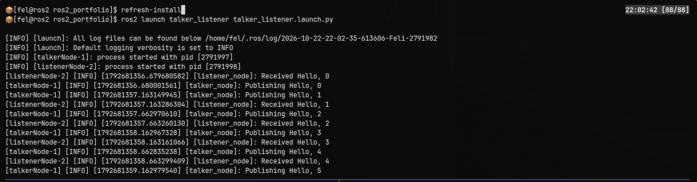
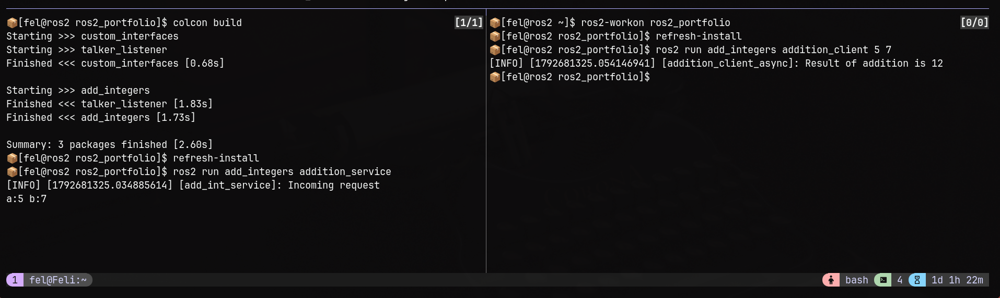

# ROS 2 Communication Patterns

Three ROS 2 packages exploring how nodes communicate: topics, services,
and custom interfaces, plus launch files, parameters, and tests.
Built with Python on ROS 2 Jazzy.

## Packages

| Package | Demonstrates | What it does |
|---|---|---|
| `talker_listener` | Topics, launch files, parameters, tests | A publisher sends messages (`Hello, 1`, `Hello, 2`, `...`); a subscriber logs them |
| `custom_interfaces` | Custom `.srv` definition | Defines the request/response types for `add_integers` |
| `add_integers` | Services and clients | A service adds two integers; a client sends the request from the command line |

## Getting started

**Prerequisites:** ROS 2 Jazzy, `colcon`

```bash
source /opt/ros/jazzy/setup.bash
git clone https://github.com/lcy08/ros2_portfolio.git
cd ros2_portfolio
colcon build
source install/setup.bash
```

## Usage

### Topics with a launch file
```bash
ros2 launch talker_listener talker_listener.launch.py
```
**Parameters:** `topic` (default `chatter`) sets the topic name the
publisher and subscriber use. Currently the value is set inside the
launch file.





### Service and client
```bash
# terminal 1
ros2 run add_integers addition_service
# terminal 2
ros2 run add_integers addition_client 5 7
```
Expected output: 



## Testing
```bash
colcon test --packages-select talker_listener
colcon test-result --verbose
```

These are integration tests built with `launch_testing`. They start the
talker and listener as real processes and check that the talker publishes
messages on its topic (and logs them), and that the listener logs a unique
message published to its topic. Each node runs on its own topic, so they
are tested independently.

## Design notes

- The talker/listener uses a **topic** because it is a continuous stream that any number of nodes can subscribe to. Addition uses a **service** because it is a single request with exactly one reply.
- I put the interface in its own package so other packages can depend on it without depending on the service implementation.
- Making the topic name a parameter lets the tests run the talker and listener on separate topics without changing any node code.

## Next steps
- Add an action server (e.g. a countdown with feedback and cancel) to complete the three communication patterns.
- Load parameters from a YAML file or launch argument.

## Background

Based on the official ROS 2 tutorials, extended with a separate custom
interface package and `launch_testing` integration tests.